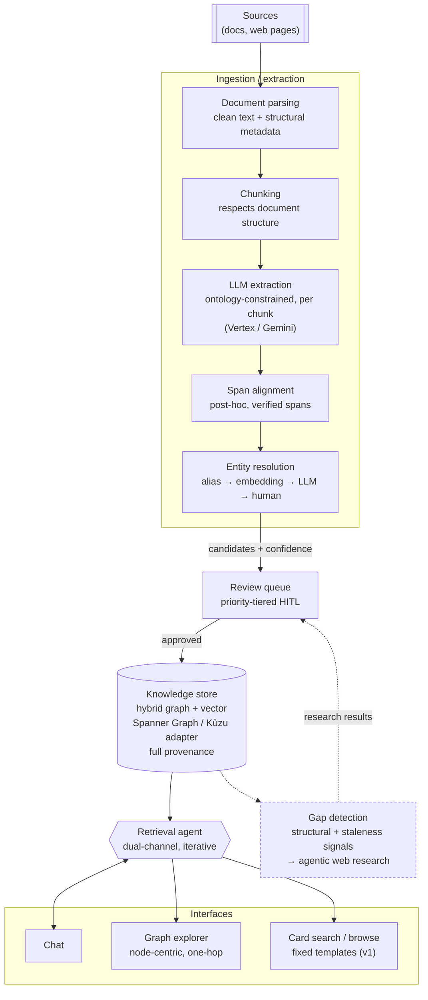

# Industry Knowledge Management System

A knowledge management system for tracking UK industry programmes, technologies, hardware, companies, standards, and tenders from open sources.

## What this is

An agentic ingestion and retrieval system: feed it documents and web pages, it
extracts structured knowledge into a hybrid knowledge graph + vector store
against a defined ontology, and you query it via natural language chat, a
node-centric graph explorer, and a card-based search/browse interface.

## High-level architecture

See `ARCHITECTURE.md` for the full design._

## Why

Two problems this is meant to solve:

- **Retention** — knowledge often lives in people's heads
  and scattered documents; things get forgotten or take too long to
  rediscover.
- **Discovery** — new, relevant developments get found too late, after the
  fact, rather than surfaced proactively. (This is the harder, less-proven
  part of the system — see `ROADMAP.md`.)

## Status

*Work in progress*

## Document map

- **`CLAUDE.md`** — working instructions and conventions for Claude Code on
  this project. Read this first if you're an agent picking up work here.
- **`ARCHITECTURE.md`** — the technical design: ontology, storage, extraction
  pipeline, entity resolution, retrieval, interfaces.
- **`DECISIONS.md`** — log of key architectural decisions and why they were
  made, so later work doesn't re-litigate settled questions.
- **`ROADMAP.md`** — staged milestones, what's in v1 vs deferred.
- **`BACKLOG.md`** — one-line intent for each milestone, before it is written
  up as GitHub issues.
- **`AUTOMATION.md`** — how the build runs: GitHub Issues and a Project board,
  driven by a lead agent with worker and reviewer agents.

## Confidentiality

All source material is open source and public (government publications, press releases, company websites, standards documents). No classified/export-controlled material is to be ingested or stored in this system.
